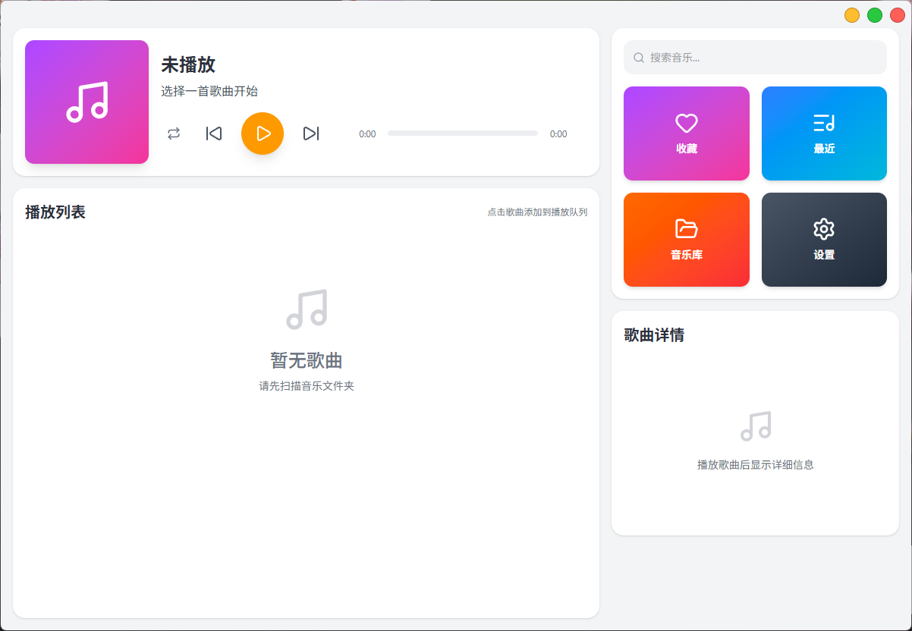
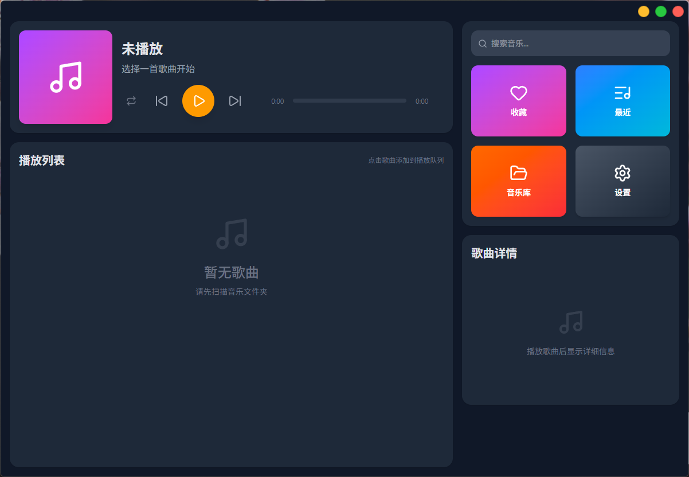

# EchoPlay

一个基于 [Tauri 2](https://tauri.app/) 构建的**本地音乐播放器**。

[](https://opensource.org/licenses/MIT)
[](https://tauri.app/)
[](https://react.dev/)

## 界面预览

浅色模式与深色模式均可使用，点击封面可进入全屏播放：

| 浅色主界面 | 深色主界面 |
| :--------: | :--------: |
|  |  |

## 环境要求

### 运行时

- Windows / macOS / Linux
- Linux 需依赖：`libwebkit2gtk-4.1-0`、`libgtk-3-0`、`libasound2`

### 开发环境

- [Node.js](https://nodejs.org/) 18+
- [Rust](https://www.rust-lang.org/) 1.90+（edition 2024）
- Tauri 2 所需的系统依赖，参见 [Tauri 前置条件](https://tauri.app/zh-cn/start/prerequisites/)

## 安装

从 [GitHub Releases](https://github.com/zhliu33/echoplay/releases) 下载对应平台的安装包即可。

## 开发

```bash
# 安装依赖
npm install

# 启动开发服务器（前端 + Tauri）
npm run tauri:dev

# 仅启动前端开发服务器
npm run dev

# 构建生产版本
npm run build
npm run tauri:build
```

## 项目结构

```
.
├── src/                    # 前端源码
│   ├── components/         # 组件（布局、播放器、列表等）
│   ├── pages/              # 页面（主页、设置页）
│   ├── stores/             # Zustand 状态管理
│   ├── player/             # 播放引擎封装
│   ├── music-sources/      # 音乐源抽象（可扩展在线源）
│   ├── i18n/               # 国际化
│   └── api/                # Tauri 命令封装
├── src-tauri/              # Rust 后端
│   └── src/
│       ├── audio.rs        # 音频播放（rodio + 前瞻缓冲）
│       ├── equalizer.rs    # 5 段 IIR 均衡器
│       ├── scanner.rs      # 音乐库扫描
│       ├── metadata.rs     # 元数据提取
│       ├── library.rs      # SQLite 数据库
│       └── cover_cache.rs  # 封面缓存
└── assets/                 # 静态资源
```

## 开源协议

MIT License